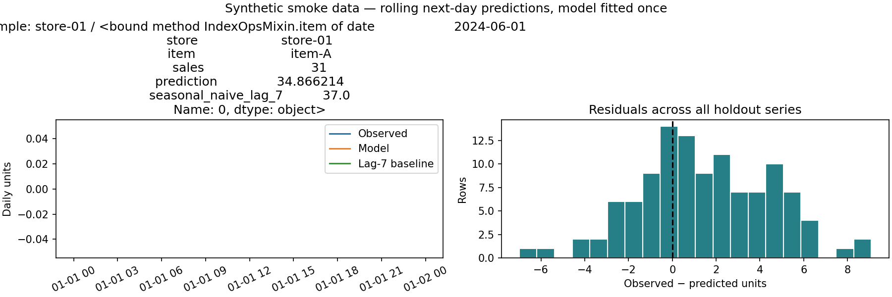
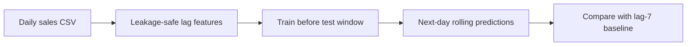

# Retail Demand Forecasting with Leakage-Aware Evaluation

A leakage-aware forecasting project for daily store/item demand. It compares a machine-learning model with a seasonal-naive baseline and evaluates next-day predictions with a chronological holdout.

[](https://github.com/ayanirfan099/retail-demand-forecasting/actions/workflows/tests.yml) 




The plot shows actual output from the bundled synthetic data, with a lag-7 baseline. It is a software demonstration, not a public retail benchmark. Reproduce with `python -m pip install matplotlib`, then `PYTHONPATH=src python scripts/plot_demo.py`. [Exact predictions, time split and metrics](reports/synthetic-diagnostics.json). The optional `include_predictions=True` evaluator argument exposes those same held-out rows; default reports are unchanged.

## Forecasting question

Given each store's and item's recorded sales through yesterday, how accurately can we forecast today's demand? The evaluation uses a rolling one-day-ahead setup: the model is fitted once before the test window, while the previous day's actual demand is available when producing each later daily forecast. This mirrors a daily reforecasting process and is different from a fixed multi-week forecast made all at once.

## Method




- Aggregate transactions to daily `store` / `item` demand.
- Build lag 1, 7, and 14; shifted seven-day mean; and calendar features.
- Fit a HistGradientBoostingRegressor (or RandomForest alternative).
- Compare against last week's same-day demand (`lag_7`).
- Report MAE, RMSE, WAPE, and MASE; report model and baseline side by side.

All lag and rolling features are shifted before use. Rows without enough history are dropped. Model selection should use rolling validation windows that end before the final test period.

## Data

Expected CSV columns:

```csv
date,store,item,sales
2024-01-01,store-01,item-A,24
```

Use licensed sales data you are allowed to analyze. The repository includes a small **synthetic** dataset for a reproducible smoke run; it is not evidence of real-world forecasting performance. Create or refresh it with:

```bash
python scripts/generate_demo_data.py
```

For a portfolio benchmark, use a public retail dataset only after checking its usage terms, aggregate it to daily store/item demand, and document the transformations and time span.

## Run

```bash
python -m venv .venv
# Windows: .venv\Scripts\activate
# macOS/Linux: source .venv/bin/activate
python -m pip install -e .
python -m unittest discover -s tests -v
python scripts/generate_demo_data.py
retail-forecast --csv data/synthetic_demo.csv --test-days 28 --report reports/synthetic-smoke.json
```

The smoke report is labeled synthetic. Do not quote it as a benchmark on real retail data.

## Evaluation protocol

1. Sort by date and reserve the latest dates for final testing.
2. Use only information available before each predicted date.
3. Compare every model with the seasonal-naive lag-7 baseline.
4. Tune hyperparameters and choose models using validation windows before the final test range.
5. Report metrics by store/item as well as an aggregate; WAPE can hide weak performance on low-volume series.
6. Keep zero-demand handling explicit. WAPE is returned as `null` when total actual demand is zero.

## Repository structure

- `src/retail_forecast/features.py`: schema checks, daily aggregation, lag/calendar features.
- `src/retail_forecast/evaluate.py`: chronological split, model fit, baseline comparison.
- `src/retail_forecast/metrics.py`: MAE, RMSE, WAPE, and MASE.
- `src/retail_forecast/cli.py`: command-line evaluation.
- `scripts/generate_demo_data.py`: deterministic synthetic example data.
- `tests/`: tests for leakage prevention, chronological splitting, validation, and metrics.

## Next engineering steps

- Add multiple rolling-origin validation cutoffs and prediction intervals.
- Add promotion and holiday features only when their values would be known at forecast time.
- Add per-series reports and a small dashboard showing forecasts and reorder recommendations.
- Document results on a licensed public dataset, including weak-performing series and limitations.
